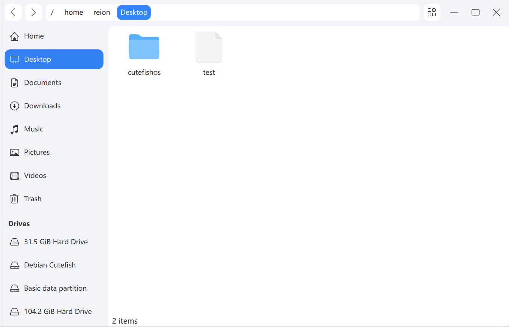

# File Manager

Cutefish File Manager, simple to use, beautiful, and retain the classic PC interactive design.



## Dependencies

File Manager is built on [cutefish-toolkit](https://github.com/cutefishos/cutefish-toolkit) and
the files library of [cutefish-framework](https://github.com/cutefishos/cutefish-framework);
install them first. The mount service needs FUSE, libssh, libsmbclient, libmtp and
libudev; archives need libarchive and libzip. GoogleTest for the tests.

Debian/Ubuntu:

```shell
sudo apt install build-essential cmake pkg-config libicu-dev libarchive-dev libzip-dev \
    libfuse3-dev libssh-dev libsmbclient-dev libmtp-dev libudev-dev libgtest-dev
```

## Build

```shell
cmake -S . -B build -DCMAKE_INSTALL_PREFIX=/usr
cmake --build build
sudo cmake --install build
```

## Tests

```shell
cmake -S . -B build -DBUILD_TESTING=ON
cmake --build build
ctest --test-dir build --output-on-failure
```

## License

BSD-3-Clause; see [LICENSE](LICENSE).
